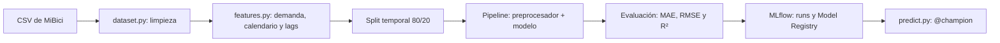

# Pipeline y modelos

## Problema
Predecir la cantidad de bicicletas que salen de cada estación por hora, con 24 horas de anticipación, para apoyar la planeación de su redistribución. La demanda es un conteo y aproximadamente el 52% de los registros tiene valor cero.

## Flujo de modelado

## Pipeline de Scikit-Learn (`modeling/train.py`)

El Pipeline integra el preprocesamiento y el modelo para garantizar que las transformaciones sean las mismas durante el entrenamiento y la predicción.

| Tipo | Variables | Transformación |
|---|---|---|
| Numéricas | `lag_24`, `lag_168`, `latitude`, `longitude` | Imputación con mediana y escalado |
| Temporales | `month` | One-hot encoding |
| Categóricas | `station_id` | Target Encoding con `KFold` |
| Precodificadas | `hour_*`, `dow_*`, `is_weekend`, `is_holiday` | Sin transformación adicional |
| Modelo | Variables anteriores | Ridge o HGB Poisson |

El preprocesador y el modelo se ajustan juntos utilizando únicamente los datos de entrenamiento. Ambos se registran en MLflow como parte del mismo Pipeline.

La evaluación se realiza con `evaluate()` sobre el conjunto de prueba.

**Ejecución:** `make pipeline` ejecuta el flujo completo.

Los archivos `train.parquet`, `test.parquet` y `preprocessor.joblib` generados por `features.py` no se utilizan directamente para entrenar, ya que pueden contener variables excluidas del Pipeline.

## Prevención de data leakage

Debido la predicción se realiza con 24 horas de anticipación, se excluyen `lag_1` y `rolling_mean_24`, porque contienen información que todavía no estaría disponible al momento de predecir.

Además, la división de datos y la validación cruzada respetan el orden temporal para evitar utilizar información futura.

## Algoritmos evaluados

| Modelo | Justificación |
|---|---|
| Baseline `lag_168` | Utiliza la demanda de la misma hora de la semana anterior. Fue la variable más correlacionada en el EDA de la Fase 1 (0.74). |
| Ridge | Modelo lineal que sirve como referencia interpretable. |
| HistGradientBoosting (Poisson) | Utiliza una función de pérdida adecuada para conteos y permite capturar relaciones no lineales. |

## Ajuste de hiperparámetros

Se utiliza `RandomizedSearchCV` con `TimeSeriesSplit` de 3 folds sobre una muestra de 500,000 filas. Después, el mejor modelo se vuelve a entrenar con todo el conjunto de entrenamiento.

Los espacios de búsqueda y parámetros se encuentran en `config.py`.

## Métricas de evaluación

| Métrica | Descripción |
|---|---|
| MAE | Error promedio en bicicletas por hora. Se utiliza para seleccionar el modelo campeón. |
| RMSE | Penaliza los errores grandes, especialmente relevantes durante las horas pico. |
| R² | Indica qué proporción de la variación de la demanda explica el modelo. |
| `cv_mae` | MAE promedio obtenido durante la validación cruzada. |

## Resultados

| Modelo | MAE | RMSE | R² | `cv_mae` | Mejora vs. baseline |
|---|---:|---:|---:|---:|---:|
| Baseline `lag_168` | 0.974 | 1.773 | 0.467 | — | — |
| Ridge (`alpha=100`) | 0.922 | 1.480 | 0.629 | 0.935 | 5.4 % |
| **HGB Poisson** | **0.802** | **1.344** | **0.694** | **0.819** | **17.7 %** |

El modelo **HGB Poisson** obtuvo el mejor resultado, con una mejora del 17.7 % en MAE respecto al baseline.

Con los siguientes hiperparámetros:

- `learning_rate=0.1`
- `max_leaf_nodes=127`
- `min_samples_leaf=500`
- `l2_regularization=0`

Para consultar el seguimiento de los experimentos y el registro de modelos, revisa [experiment_tracking.md](experiment_tracking.md).

## Limitaciones y mejoras futuras

- **Selección del campeón:** actualmente se utiliza el MAE del conjunto de prueba; sería preferible seleccionar el modelo mediante `cv_mae`. En esta corrida, el ganador sería el mismo.
- **Búsqueda de hiperparámetros:** algunos valores óptimos alcanzaron los límites del espacio de búsqueda (`alpha=100`, `max_leaf_nodes=127` y `min_samples_leaf=500`). Sin embargo, las tres mejores configuraciones de HGB obtuvieron resultados muy similares.
- **Cobertura temporal:** noviembre y diciembre no están representados en el entrenamiento con los datos de 2024. Utilizar la versión `v2`, con el histórico completo, permitiría resolver esta limitación.
- **Evaluación por horario:** el ML Canvas contempla reportar MAE y RMSE por franja horaria, pero actualmente solo se calculan métricas globales.
- **Sobreajuste:** no se registra el MAE de entrenamiento, por lo que no es posible medir directamente la diferencia entre el desempeño en train y test.
