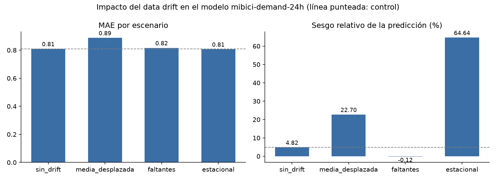

# Data drift y pérdida de desempeño (Entrega Final, Punto 5)

**Código:** `mibici_demand/monitoring.py` · **Parámetros:** `MONITORING_PARAMS` en `config.py` ·
**Comando:** `python -m mibici_demand.monitoring` (usa `models/champion`, sin servidor MLflow)

## Diseño

| Elemento | Decisión |
|---|---|
| Modelo | `models:/mibici-demand-24h/4` (el mismo de la imagen Docker) |
| Conjunto de validación | Periodo de test (21-oct a 31-dic-2024); dos muestras de 50,000 filas (semilla 42): referencia y conjunto actual |
| Control | `sin_drift`: el conjunto actual sin alterar (verifica que no haya falsas alarmas) |
| Detección | Evidently `DataDriftPreset` sobre `lag_24`, `lag_168`, `hour_sin/cos`, `dow_sin/cos`, `is_weekend`, `is_holiday`. `month` se excluye: el split temporal lo hace derivar siempre |

| Escenario | Simula | Alteración |
|---|---|---|
| `media_desplazada` | Error del feature pipeline | `lag_24` y `lag_168` × 1.5; la demanda real no cambia |
| `faltantes` | Falla de una fuente de datos | 30 % de `lag_168` vacío |
| `estacional` | Vacaciones | La demanda real y `lag_24` caen al 60 %; `lag_168` (semana previa) no |

## Criterios de alerta

| Estado | Condición | Acción propuesta |
|---|---|---|
| **ALERTA** | MAE ≥ +10 % vs control **o** \|sesgo relativo\| ≥ 15 % | Revisar el feature pipeline; si los datos son válidos, reentrenar con datos recientes |
| **AVISO** | ≥ 30 % de variables con drift **o** > 5 % de nulos en una variable | Nulos: revisar el feature pipeline. Drift sin pérdida: vigilar |
| **OK** | Ninguna de las anteriores | Ninguna |

Sesgo relativo = (media de la predicción − media real) / media real.

## Resultados

| Escenario | MAE | Δ MAE | R² | Sesgo | Variables con drift | Nulos | Estado |
|---|---|---|---|---|---|---|---|
| `sin_drift` | 0.810 | — | 0.691 | +4.8 % | 0 % | 0 % | OK |
| `media_desplazada` | 0.888 | +9.6 % | 0.604 | **+22.7 %** | 25 % | 0 % | **ALERTA** |
| `faltantes` | 0.816 | +0.8 % | 0.667 | −0.1 % | 0 % | **29.9 %** | **AVISO** |
| `estacional` | 0.807 | −0.4 % | **0.267** | **+64.6 %** | 12.5 % | 0 % | **ALERTA** |

Detalle: [`reports/drift/summary.csv`](../reports/drift/summary.csv), un reporte HTML de Evidently
por escenario en `reports/drift/` y la gráfica `reports/figures/drift_performance.png`.

## Hallazgos

1. **El MAE por sí solo engaña.** En `estacional` el MAE *mejora* (−0.4 %) porque hay menos viajes
   que errar, pero el modelo sobreestima la demanda 65 % y el R² cae de 0.69 a 0.27. Por eso la alerta
   combina MAE y sesgo.
2. **El drift estadístico no detecta todo.** Evidently no marca los nulos de `faltantes` como drift y
   el MAE casi no cambia (el imputador y `lag_24` compensan). Sin la regla de calidad de datos, esta
   falla pasaría en silencio.
3. **`media_desplazada` queda justo bajo el umbral de MAE (+9.6 %)**; la detecta el sesgo (+22.7 %).
   Un solo umbral habría dejado pasar un error de pipeline.
4. **El control no genera falsas alarmas**: 0 % de variables con drift y estado OK.
